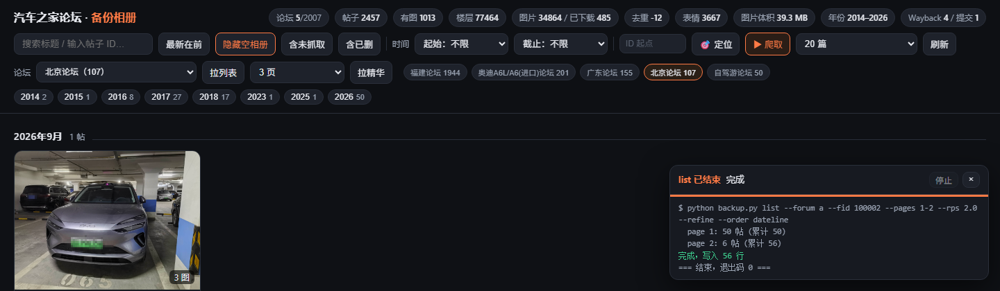
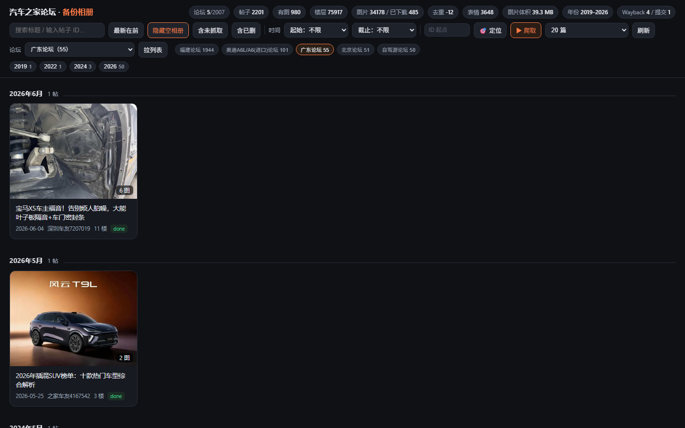
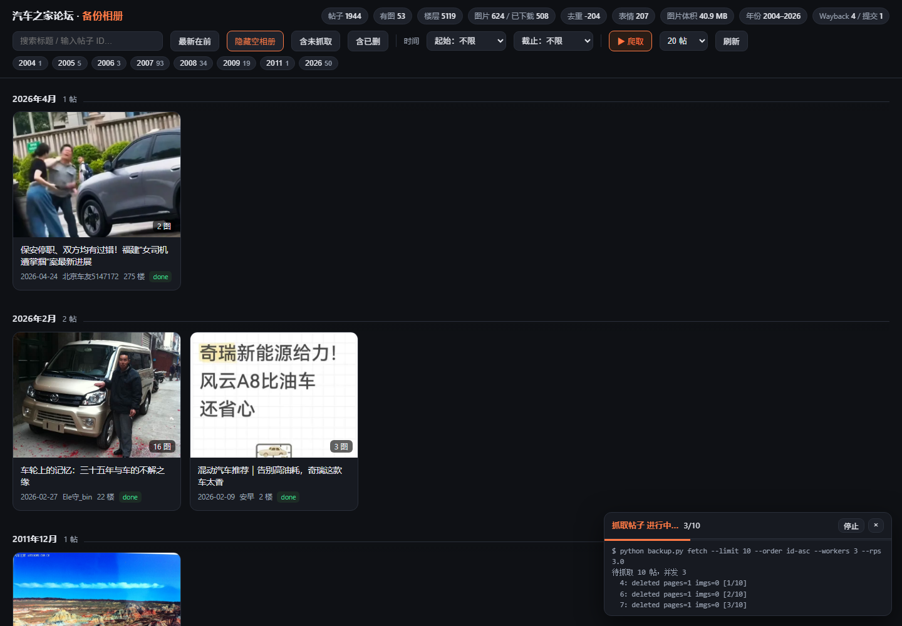

# 汽车之家论坛备份工具

把 club.autohome.com.cn 的帖子（正文 + 全部回复 + 图片）抓成本地原样存档，附带：

- **Wayback 补档**：对 Wayback Machine 里没有快照的帖子，自动提交 Save Page Now 请求；
- **相册浏览界面**：本地网页里按帖子浏览图片、看楼层正文、全屏灯箱。

数据落在一个 SQLite 库 + 一个图片目录里，随时可以增量续跑。

---

## 快速开始

```powershell
cd E:\DSwork\autohome-backup

python backup.py init                      # 建库/建目录
python backup.py list --pages 1-20         # 抓论坛列表（每页 50 帖）
python backup.py fetch  --limit 200 --workers 4 --rps 8
python backup.py images --limit 2000 --workers 4 --rps 8
python backup.py wayback --limit 100 --submit   # 补存档到 Wayback
python backup.py status

python gallery\server.py --port 8765       # → http://127.0.0.1:8765/
```

日常增量只需要一条命令：

```powershell
python backup.py update --pages 2 --fetch 50 --images 300 --wayback 10
```

它会依次跑：抓列表前 2 页 → 抓 50 帖 → 下 300 张图 → 查/补 10 条 Wayback，最后打印进度。

默认目标论坛是**福建论坛 a-100004**（`--forum a --fid 100004` 可换）。

---

## 命令一览

| 命令 | 作用 |
| --- | --- |
| `init` | 建数据库与 `raw/`、`img/` 目录 |
| `forums [--probe-prov] [--probe-ids c-18,o-200042] [--keep N]` | 导入论坛目录（站内首页一次拿全站论坛名），`--probe-*` 顺便记下每个论坛的帖子总量 |
| `list --pages 1-20 [--order dateline] [--forum c --fid 18]` | 抓 `/o/bbs/forum-*.html` 列表，写入 topic |
| `cdx --start 2009 --end 2014 [--cdx-pages 1]` | 从 Wayback CDX 捞历史 URL，作为"早期帖子"种子 |
| `resolve` | 给缺 hash 的帖子补 hash（走 301 解析规范 URL） |
| `fetch [--limit N] [--topic ID...]` | 抓帖子正文与全部回复页，落 `raw/*.html.gz` + 解析入库 |
| `fetch --valid 20 [--max-attempts 120]` | **抓够 20 篇有效帖才停**：已删/空贴不算数，自动跳过 |
| `fetch --from-id 20000000 [--to-id 30000000]` | **指定游标起点**：只抓 topicId 落在该区间的帖，用来跳过已经遍历过的号段 |
| `fetch --only-forum c-18` | **只抓某个论坛的队列**（配合论坛层用，别把别的论坛的帖混进来） |
| `images [--limit N] [--topic ID] [--retry-errors]` | 下载图片到 `img/<topicId>/`；`--retry-errors` 重试之前失败的 |
| `wayback [--limit N] [--submit] [--dry-run]` | 查 Wayback 是否有快照；没有就提交 SPN |
| `export --from 2006-01 --to 2009-12 [--raw]` | 把一段时间/一组帖子打成 zip（离线相册 + 文本 + 图片） |
| `walk --from-id A --to-id B` | 按 topicId 暴力枚举一段 ID 空间，把存的帖子捞进队列 |
| `crawl --from-year 2005 --to-year 2013` | 从最早的内容开始爬：CDX 播种 → 补 hash → 按 ID 升序抓 |
| `update [--pages 2] [--fetch 50]` | 一条命令跑一轮增量（列表→帖子→图片→Wayback） |
| `probe` | 探一下现在能不能抓（是否还被人机验证拦着） |
| `recheck --since "2026-10-27 16:00"` | 复核被判"已删"的帖子，能打开的放回队列 |
| `status` | 看进度、体积、年份跨度 |

通用参数：`--data-dir`（默认 `./data`）、`--rps`（全局限速）、`--workers`（并发线程）。

---

## 抓的是什么

- 帖子页走**旧版服务端渲染页** `/o/bbs/thread/{hash}/{id}-{page}.html`：
  正文、每一层回复、作者、时间、图片真实地址全在 HTML 里，不需要浏览器、不需要登录。
- 图片懒加载的老帖用 `src9="真地址"`，新帖用 `data-src` —— 解析时都已处理。
- 原始 HTML 存 `raw/<topicId>/page-<n>.html.gz`，解析结果存 `floors` 表（可重建）。
- `img/<topicId>/<楼层>-<序号>-<图片行id>.<ext>`，`images` 表记录 URL / 本地路径 / 字节数 / 状态。

数据库表：

```
topics(topic_id PK, title, author_*, publish_at, reply_count, pages_total, hash, status, source, fetched_at …)
floors(topic_id, page, floor_no, member_id, author, posted_at, text, images)   -- 主键(topic_id,page,floor_no)
images(id, topic_id, page, floor_no, seq, url, local_path, bytes, status, is_face, sha1)
wayback(url PK, topic_id, available, snapshot_ts, submitted_at, status, note)
```

`topics.status`：`new` 待抓 / `partial` 抓到一半 / `done` 完成 / `deleted` 帖子已删 / `error` 失败。

> 早期文件名是 `<页码>-<序号>`，同一页里不同楼层的第 0 张图会**互相覆盖**（一份文件被多行共用）。
> 现已改成 `<楼层>-<序号>-<图片行id>`，并用 `--retry-errors` 重下了受影响的行。

---

## Wayback 补档（这一块最容易踩坑，先说清楚）

**判断"有没有快照"必须用 CDX，不能用 `/wayback/available`。**
CDX 里存的老 URL 是 `http://club.autohome.com.cn:80/bbs/thread-a-100004-136267-1.html` 这种带 `:80` 的形式，
`available` 接口按字符串精确匹配，会把这些**全部误报为"未归档"**。程序里改成 CDX 精确查询
（CDX 自己会做 URL 规范化），并且同时查**规范地址**和**旧式 `thread-a-100004-{id}-1.html` 地址**，
任一命中就算已归档。

**提交 SPN 的真实协议**（和网上很多示例不一样）：

1. `POST https://web.archive.org/save/`，表单 `url=<页面地址>`；
2. 返回一张 HTML 页面，里面调用 `spn.watchJob("spn2-xxxxxxxx", …)` —— 从这串里拿 job id；
3. 轮询 `GET https://web.archive.org/save/status/<job id>`，`status` 从 `pending` 到 `success`，
   成功后 JSON 里有 14 位 `timestamp`，`first_archive: true` 表示这是首次存档。

程序按这个流程实现，单个任务一般 25–40 秒完成。注意：

- SPN 有配额（未登录大致每分钟十几条），`--submit-interval` 控制提交间隔，别猛刷；
- 只归档**第 1 页**（后续页另算，可按需扩展成每页一条）；
- 提交前一律先查 CDX，已归档的不重复提交。

### 死亡图片的兜底

2007 年前后那批 `www.autoimg.cn/album/2007/...`、`img.autohome.com.cn/album/...`
已经被源站删干净（全部 404）。`images` 命令在拿到 403/404/410 时会去 Wayback 查同一张图的
快照（CDX 精确查 → `/web/<ts>im_/` 取原图），取到就落盘并在 `images.error` 里记
`wayback:<ts>`；CDX 返回 429 时把该行退回 `new` 状态、留待下次重试，不会误判成"永久失效"。

实测：福建论坛 a-100004 的 646 张图里 45 张属于这种情况，其中 4 张在 Wayback 里有快照、已补回，
其余 41 张两边都没有 —— **这部分图片是永久丢失的**，只能留 URL 做记录。

---

## 相册界面

`python gallery\server.py --port 8765` → <http://127.0.0.1:8765/>

- **论坛层**：顶栏「论坛」下拉 + 快捷胶囊，可在全站 / 单个论坛之间切换；切到某个论坛后，年份胶囊、月份下拉、统计数字都只算这个论坛；卡片右下角会标出帖子所属论坛；
- 卡片墙：封面、标题、日期、作者、楼层数、图片数、抓取状态；
- **按月份分块**：月份标题吸顶（`2026年10月 · 3 帖`），滚动时始终知道自己在哪个月；吸顶的偏移量由 JS 实时量取顶栏高度写进 `--hdr`，工具条换行变高也不会压住卡片；
- **时间筛选**：顶栏年份胶囊（带帖子数）+ 起止月份下拉，任意区间组合；点年份胶囊可一键进/出该年；
- 搜索（标题或帖子 ID）、**隐藏空相册**（默认开：只留至少有一张真实图片的帖）、"含未抓取"、**三态排序（最新在前 → 最早在前 → 最近抓取）**、分页加载；
- **默认表情自动剔除**：论坛内置表情（`/album/smiles/`、`/images/face/` 等）不算图片，不下载、不计入封面与图数；帖子页可「含表情」临时查看；
- **图片内容去重**：按 SHA-1 指纹合并"不同 URL、同一张图"的重复，相册里标 `×n`，悬浮可看它出现在哪几楼；
- **缺失图有明确占位**：本地没落盘的图先直连远端尝试加载，加载失败才显示斜纹占位格 + 失败原因（如 `http404`），点它打开远端原址；右上角「补缺失图（N）」一键把这些图抓到本地（离线可看）；
- **防盗链已处理**：`autoimg.cn`（`www`/`club0-2`）按 Referer 白名单拦图，本地页面若带上 `http://127.0.0.1:8765/` 会被 **403**，看似"全部加载失败"。页面用 `<meta name="referrer" content="no-referrer">` 统一不发 Referer，图片即可正常显示；下载器则固定带 `Referer: https://club.autohome.com.cn/`；
- **多选导出**：卡片左上角勾选，底部浮出「导出所选」；「导出筛选结果」按当前时间区间整段导出；
- **在界面里直接爬**：右上角「▶ 爬取」按当前批量（10/20/50/100/200/500/1000 **篇有效帖**，1000 为上限）从最早期号往下抓，已删帖不计入数量；旁边的 **`ID 起点`** 输入框可以指定游标从哪里开始（例如刚从 2000 万号段走完，就填 `20000000`，省得从 1 号重新空跑；填过会记住，下次自动带出）；右下角任务面板实时显示进度、可随时停止；帖子页「抓这个帖」单独重抓一篇；
- **🎯 定位**：不知道游标该填几时点它——服务端会算出「队列里最早还没抓的帖子」的 topicId（topicId 全站递增、和时间同序，所以这就是最早没备份的那篇），自动填进 `ID 起点`，并弹窗告诉你依据：待抓多少篇、最早那篇是什么、已抓/已判失效多少、已经扫过多少个号。队列抓空时会改成「接着扫新号」（已扫过的最大 ID + 1）。对应接口 `GET /api/resume`；
- **「拉列表」按钮**：选中某个论坛后点它，就把这个论坛最新 3 页列表拉进库（不用回去开命令行）；没选论坛时按钮是灰的；
- **「▶ 爬取」跟着论坛走**：在某个论坛视图下点爬取，只抓这个论坛的队列（`--only-forum`），不会把别的论坛的帖混进来；在「全部论坛」下则是全站队列；
- 点进帖子 → 图片九宫格式相册 + 下方楼层正文（文字与缩略图），右上角「导出此帖」；
- **导出图片 ⤓**：把当前这篇的图片打包成 zip 直接下载（文件名 `001-000-00.jpg` = 页-楼-序，只含**已下载到本地**的图），包内附 `manifest.txt` 列出每张图的来源 URL 和缺失清单；一张都没下过时会提示先点「补缺失图」。对应接口 `GET /api/album_zip?topic=<id>`；
- 点图进入全屏灯箱：`←`/`→` 翻页、`Esc` 关闭、"原图 ↗"打开远端原图；
- 有 Wayback 快照时，帖子页右上角给出快照链接。
- 筛选状态可以直接写进 URL 分享：`/?from=2005-01&to=2013-12&sort=old`，或 `?sort=fetched` 看最近抓了哪些。

纯标准库（`http.server` + `sqlite3`），只读，不写库，不开端口给外网。








---

## 论坛层（哪些论坛、各有多少帖）

站内**没有任何一处**能一次列出「全站所有论坛」的接口，但首页把三类入口都铺在同一页上，所以目录是"扫首页"扫出来的：

```powershell
python backup.py forums                      # 抓两个首页，导入论坛目录（2007 个）
python backup.py forums --probe-prov         # 顺便记下每个省级地区论坛的帖子总量
python backup.py forums --probe-ids c-18,o-200042 --keep 50
```

- 目录：`forums` 表（`bbs_type`、`bbs_id`、`name`、`topic_total`、`probed_at`）。当前 **2007 个**：地区论坛 398、车系论坛 1556、其他 53；
- `topic_total` 来自旧版列表页脚的「本坛帖子：N」，一次请求一个论坛；
- 数量级参考（都是官方自己标的）：自驾游 **5,009,321**、上海 656,718、北京 421,846、广东 309,756、奥迪A6L 316,178、福建 72,019；
- **每个论坛的列表同样卡在 1000 页 / 5 万帖**（页脚写 `共1000页`），这条上限在全站成立，不是福建论坛的特例；
- 网页里用 `?forum=c-18` 直接切到某个论坛，接口是 `GET /api/forums` 与 `GET /api/topics?forum=<type>-<id>`。

让一个论坛动起来的完整流程（以前只能靠命令行，现在界面里也能点）：

```powershell
# 1) 拉列表：这个论坛最新几页（每页 50 帖）
python backup.py list --forum c --fid 18 --pages 1-3

# 2) 只抓这个论坛的队列
python backup.py fetch --only-forum c-18 --valid 20 --limit 40
```

网页里等价于：左侧「论坛」选到该论坛 → 点 **拉列表** → 点 **▶ 爬取**。

---

## 集合导出

三种用法，产物都是同一个结构的 zip：

```powershell
# 1) 命令行：按时间区间
python backup.py export --from 2006-01 --to 2009-12 --out exports\2006-2009.zip

# 2) 命令行：指定帖子（可加 --raw 附原始 HTML）
python backup.py export --topic 13510439 50000 --raw

# 3) 网页：勾选若干帖子 →「导出所选」，或按当前筛选条件 →「导出筛选结果」
```

zip 内容：

```
manifest.json          每帖的标题/日期/作者/图片数/缺失图片 URL
index.html             离线卡片墙，双击即可看
topic_<id>.html        单帖静态页（楼层正文 + 内嵌本地图）
posts/<id>.txt         纯文本楼层，方便 grep / 做语料
img/<id>/<页>-<序>.jpg  已下载的图片
raw/<id>/*.html.gz     原始 HTML（--raw 时才有）
```

图片已经落盘的直接复用本地文件，不重复下载；缺图的会在 manifest 里标出来。


---

## 从最早的内容开始爬

站内列表够不到 2014 年以前（见「能力边界」），所以 `crawl` 走的是**外部索引播种 + 升序抓取**：

```powershell
python backup.py crawl --from-year 2005 --to-year 2013 --cdx-pages 6 --rounds 25 --batch 80
```

它做三件事：

1. **CDX 播种**：从 `web.archive.org/cdx` 按 `thread-a-100004-*` 捞 2005–2013 出现过的一切帖子 URL
   （软链接、只看楼主、翻页各种形式的 URL 都会被折叠成 topicId），写进 `topics` 表；
2. **补 hash**：对缺规范地址的条目，用 `/bbs/thread-a-{fid}-{id}-1.html` 的 301 拿到新式 hash 地址；
3. **升序抓取**：`fetch --order id-asc`，topicId 越小越早，天然就是"从最开始的时间爬"。

早期 ID 段里大量帖子已被删除（2005–2008 区间实测约三到五成是 302 回首页），所以按"条数"抓一批会
大量浪费在空号上。用 `--valid` 指定**要凑够多少篇有效帖**，程序自己往下多试：

```powershell
python backup.py fetch --valid 50 --order id-asc --workers 3 --rps 5   # 抓够 50 篇有内容的就停
python backup.py fetch --valid 50 --max-attempts 400                  # 最多试 400 个 ID
```

界面上「▶ 爬取」用的就是这个口径：选「20 篇有效帖」= 无论中间遇到多少个已删号，都要拿到 20 篇真帖。
批量上限 **1000**（`MAX_BATCH`）：界面下拉最大 1000，命令行传更大的数会被自动夹到 1000，
`--limit` 最多放宽到 2000、`--max-attempts` 最多 4000，避免一条命令失控跑一整天。

补 ID 缺口用 `walk`（一次 301 探测约 0.15 秒，已走过的记在 `walked` 表里不会重复）：

```powershell
python backup.py walk --from-id 1 --to-id 200000 --max-requests 5000 --rps 8
```

---

## 速度与礼貌

实测单 IP 10 req/s 未触发风控，程序默认 `--rps 3` 左右比较稳。
但请注意：**club.autohome.com.cn/robots.txt 明确 Disallow 了 `/o/bbs/*`**（本工具用的正是这条路径）。
技术上可抓，合规上属于"未获授权"。建议：小批量、低频、仅作个人研究用途，或先与站方沟通。
`/bbs/thread/...` 规范页没有被 robots 禁止，可以优先用它（`fetch` 里可切换 base url）。

### 被风控拦了怎么办

被拦时站点不会返回 403，而是 **302 跳到 `safety.autohome.com.cn/userverify/index?locnum=...&backurl=...`**（一个人机验证页），
于是"页面里没有帖子正文"。如果程序把这当成"帖子已删"，一次就能把成百上千篇真帖标成空号——这就是 2026-10-27 16:37 那次
"连续几百个空号"的原因（当时 4 分钟内 1132 篇被误判，已全部放回队列）。

现在程序的处理：

- `Http.request` 里识别这种跳转，**退避重试 20s → 40s → 80s**，仍然被拦就抛 `Blocked`；
- 抓到 `Blocked` 的帖子**保持原状态（待抓）**，不写 `deleted`；
- 连续 3 次被拦，本轮直接中止并提示降低频率；
- `walk` 遇到人机验证立即停止，已走过的 id 留在 `walked` 表里，下次从断点继续。

自检与补救：

```powershell
python backup.py probe                                   # 三发探针：现在还能不能抓
python backup.py recheck --since "2026-10-27 16:00" --limit 300   # 复核被误判的“已删”
```

`probe` 全部显示"人机验证（被拦截）"就继续等，通常 20–60 分钟恢复；恢复后再跑 `recheck`，
能把风控期间误判的帖子自动放回队列。**别在拦截期间反复重试**，只会延长封锁。

同时注意：多个任务并行会叠加速率（例如 `walk --rps 6` + 界面「爬取」4 req/s ≈ 10 req/s），
风控按的是 IP 总速率，同一时间只跑一个任务。

---

## 为什么别的论坛只能看到近期帖子？

不是抓漏了，是站点自己的限制。每个论坛的帖子列表**最深处只到第 1000 页**（每页 50 条 = **5 万帖**），
再往后翻会返回和最后一页一模一样的内容，也没有任何按年份/月份筛选的参数（`dateline`、`year`、`type=103…` 实测全被忽略）。

所以能回溯到多早，取决于这个论坛的总帖量：

| 论坛 | 总帖量 | 列表能回溯到 |
| --- | --- | --- |
| 福建 a-100004 | 7.2 万 | 2014-04 |
| 奥迪 A6L c-18 | 31.6 万 | 2020-08 |
| 北京 a-100002 | **42 万** | **2026-02**（几乎全是“近期”）|
| 自驾游 o-200042 | 500 万 | 2026 年 |

可用的三段式做法：

1. **把 5 万帖窗口吃满**：论坛条上的页数选择改成 `100` 或 `1000` 再点「拉列表」（1000 页 ≈ 1000 次请求，rps 3 时约 6 分钟）。
2. **拉精华**：`?type=101` 是站点的“精华”集合，数量很少但年代很早——北京只有 56 条，却横跨 2014-04~2023-06；奥迪 86 条，2014-09~2017-09。点一下就能把这些“日历最前面”的帖子补进来，年份胶囊会立刻多出 2014~2018。
3. **早期的正解是 Wayback（已实测可用）**：论坛条上选好论坛点 **「存档播种」**，或命令行
   `python backup.py crawl --forum a --fid 100002 --from-year 2005 --to-year 2013`。
   它先问 CDX「这个论坛 2005–2013 有哪些帖子被存档过」，再对每个 ID 走 301 解析出 hash，最后逐篇抓回来。

   实测（2026-10-29，美国节点）：

   | 论坛 | CDX 命中 URL | 新增早期帖子 | 已抓回的早年帖 |
   | --- | --- | --- | --- |
   | 北京 a-100002 | 3255 | 2264 | （解析中）|
   | 奥迪 A6L c-18 | 3670 | 2797 | 2005×1、2006×15、2008×97 |

   注意：`web.archive.org` 在国内解析会被污染（曾指向 `66.220.147.11`，Facebook 的 IP），
   连不上时 CDX 会直接失败——换节点或走代理即可，`archive.org` 本身一般是通的。

> 一句话：**小论坛（≤5 万帖）站内可以全量；大论坛站内只有最近 5 万帖 + 几十条精华，2005–2013 得靠存档索引。**

## 铺开：一次给所有大论坛播种（2026-10-29 实测）

两个脚本，都是可反复跑、断点续传的：

```bash
# 1) 把"有规模"的论坛逐个到 Wayback 里找 2005–2013 的老帖
python seed_all.py --min-total 12000 --cdx-pages 2

# 2) 慢慢排干队列：解析 301 拿 hash → 按 topicId 升序抓（越早越先抓）
python drain.py
```

`seed_all.py` 会读 `forums` 表里已经探过规模的论坛（当前 39 个），按帖量从大到小逐个查 CDX，
日志写到 `seed_all.log`。`drain.py` 是"解析一小批 + 抓一小批"的循环，单进程、不并发，
刻意压着速度（resolve 1.5 req/s、fetch 1.8 req/s × 2 workers），避免再触发人机验证；
随时 Ctrl+C，进度都在库里。

实测结果（36 个论坛，帖量 ≥ 1.2 万）：

| 指标 | 数值 |
| --- | --- |
| CDX 命中的存档 URL | 平均 1500–3700 / 论坛 |
| 新增早期帖子（去重后） | **39210 条** |
| 覆盖论坛 | **34 个**有数据（福建、奥迪、山东、广东、北京、四川、江苏、浙江、上海、天津…）|
| 库规模 | 46.7k 帖 / 待解析 41.2k |

> 解析是瓶颈：每篇要发一次 301 请求（`/bbs/thread-a-{fid}-{id}-1.html` → 规范页拿 hash），
> 1.5 req/s 下 4 万条约需 7–8 小时；抓取比解析快（每帖 1–N 页）。`drain.py` 会自动按这个节奏跑。

## 服务总是关掉？（Windows）

相册服务是普通后台进程，**关掉命令行窗口 / 结束那个 job 就会一起没**。想让它长期挂着：

- 双击 **`后台运行相册.bat`**：用 `pythonw` 起，独立于当前终端，关黑窗口也不停，并自动打开浏览器；
- 双击 **`停止相册.bat`**：按 `gallery/server.pid` 里的进程号停掉它；
- 端口被占时会先探一下 `/api/stats`：若已有本程序在跑，会打印「[已在运行]」并直接退出，
  不会再出现"起了新进程但其实还是旧进程在应答"的假象（Windows 上 `SO_REUSEADDR` 默认允许两个进程绑同一端口，
  代码里已对 Windows 关掉它，改成独占绑定）。

## 当前进度（首次跑通后的实测数据）

| 指标 | 数值 |
| --- | --- |
| 论坛目录 | 2007 个（地区 398 / 车系 1556 / 其他 53），已有数据的 5 个（福建 1944、奥迪A6L 101、广东 55、北京 51、自驾游 50） |
| 已知帖子（列表 + CDX 播种 + ID 遍历） | 2201 |
| 已抓取帖子 | 1571 完成 / 532 已删（含复核后确认失效的）/ 6 部分完成 / 92 排队中 |
| 楼层 | 75917 |
| 图片 | 34178 张（内容去重后 34166 张），已落盘 485 张（39.3 MB），另有 3648 个默认表情按规则忽略 |
| 占用 | 约 330 MB（库 + 原始 HTML + 图片） |
| 时间跨度 | **2002-06-26** ～ 2026-10-29 |
| Wayback | 已确认存在 4 篇、新提交 1 篇 |

> 最早一篇正是全站 `topicId=1`：2005-04-07 李想的「加装导航一体机」——`crawl` 按 ID 升序抓，
> 所以队列一启动就是它。CDX 播种一次能吐出上千条历史 URL，抓取速度远低于发现速度，
> 队列里随时会挂着上百条待抓；继续 `python backup.py crawl ...` 或 `update` 会顺着队列往下走，
> 不想算从哪个号接着抓，就点界面上的 **🎯 定位**。
>
> 早期 ID 并不连续：`walk` 实测 1～300 有 193 篇存活，1900～2800 整段不存在（返回 302 回首页）。
> 所以「从最早开始爬」的正确姿势是 **CDX 定种子 + ID 升序抓**，`walk` 只用来补窟窿，别拿它当主要发现手段。

---

## 能力边界（重要）

1. **站内列表最多回溯 5 万帖/论坛**：`/o/bbs/forum-*` 的 `page` 超过 1000 后被钳制成第 1000 页的内容
   （a-100004 只能到 2014-04，c-18 只能到 2020-08）。旧版 API 更浅，200 页封顶。
   → **2005–2013 的帖子无法靠站内列表枚举**。
2. 早期内容只能靠外部索引播种：Wayback CDX（已实现）、搜索引擎结果页、站内搜索（若有）等。
3. 全站 topicId 近乎稠密（≈1.16 亿），靠 ID 暴力枚举需百天级，不可行。
4. **论坛多、但各论坛的列表深度同样只有 5 万帖**：全站 2007 个论坛，官方标的帖子总量相加远大于能枚举到的量
   （例如自驾游 500 万帖，只能翻到最近 5 万），所以"多论坛"不等于"全站都能枚举到"。
5. 部分老帖只有楼主楼层被渲染（threadowner 视图），或被删楼层显示"本楼已被删除"，属正常。
6. 用户名在部分新版页面的楼层里没有（只有 `data-member-id`），能取则取，取不到留空。

---

## 目录结构

```
autohome-backup/
├─ backup.py            # 主程序（init/list/cdx/resolve/fetch/images/wayback/export/walk/crawl/update/status）
├─ exportlib.py         # 集合导出（zip 打包，被命令行和网页复用）
├─ gallery/
│  ├─ server.py         # 本地只读 HTTP 服务
│  └─ index.html        # 单文件前端（月份分块 + 时间筛选 + 表情过滤 + 去重 + 多选导出 + 爬取按钮 + 相册 + 灯箱）
├─ exports/             # 导出的 zip 落在这里
├─ data/
│  ├─ autohome.db       # SQLite（WAL）
│  ├─ raw/<id>/*.html.gz
│  └─ img/<id>/*.jpg
└─ README.md
```
